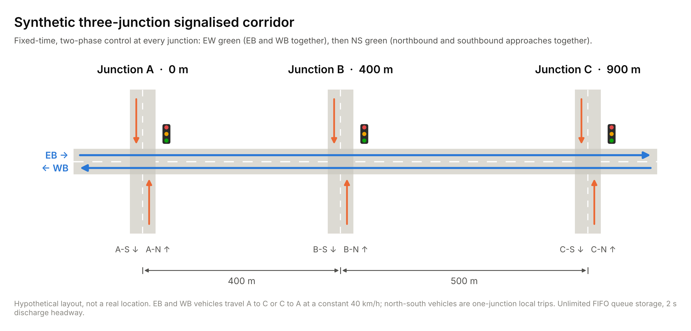
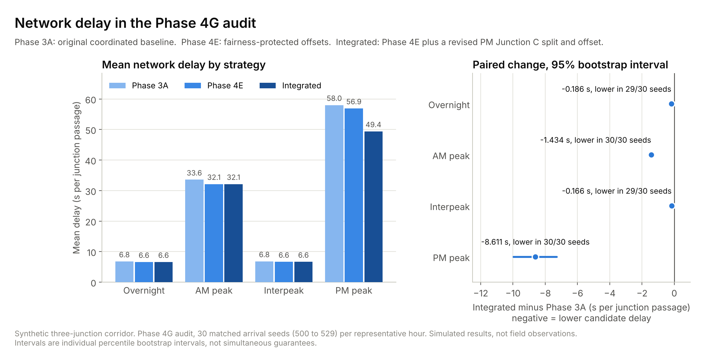
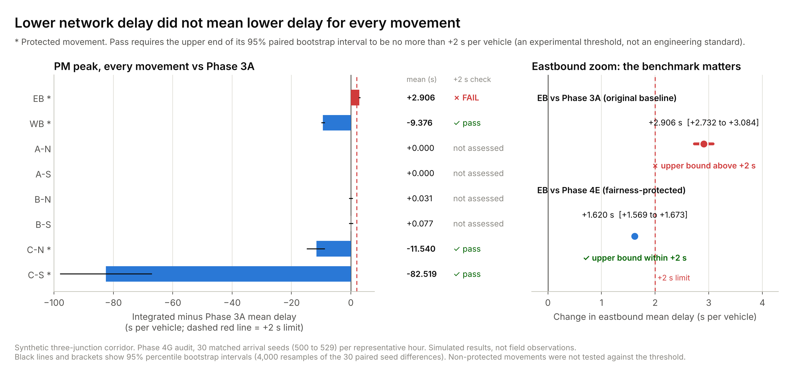
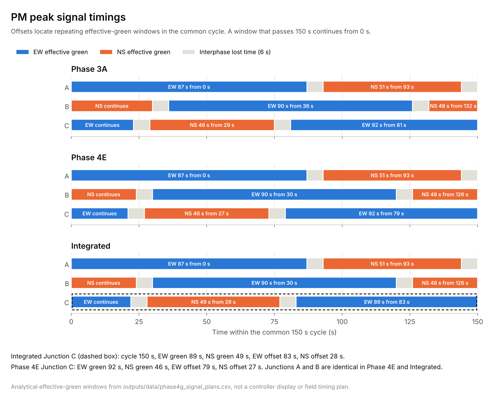

# Traffic Signal Optimisation

## Python-Based Traffic Signal Coordination and Network Performance Evaluation

An independent, educational Python project that asks a simple question: **can retiming
traffic lights cut congestion without making any direction worse?**

It simulates a three-junction road with made-up traffic, tests several signal timing
plans on the same 30 random rush hours, and checks both the overall delay and the delay
for each direction of travel.

**Website:** [nanxi-lu.github.io/traffic_signal_optimisation](https://nanxi-lu.github.io/traffic_signal_optimisation/)



**In short:** the best of the original plans cut the average evening-peak wait by
8.6 seconds per junction, but eastbound drivers waited 2.9 seconds longer, breaking the
2-second fairness limit set at the start. A follow-up search (Phase 4H) that checked
fairness against the original plan found a timing that saves 10.5 seconds and keeps every
protected direction within the limit.

---

## Contents

- [A. Project overview](#a-project-overview)
- [B. Main findings](#b-main-findings)
- [C. Interactive results](#c-interactive-results)
- [D. The road and the timings](#d-the-road-and-the-timings)
- [E. Methodology](#e-methodology)
- [F. Limitations](#f-limitations)
- [G. Reproducibility](#g-reproducibility)
- [H. Related project](#h-related-project)
- [Project structure](#project-structure)

---

## A. Project overview

**The problem.** At every signalised junction, green time is shared between competing
traffic. Give more to one direction and another waits longer. Linking neighbouring
junctions so cars meet a "green wave" helps one direction, but can cost the other
direction and the side roads.

**What the project does.**

- Builds a day of simulated traffic for three junctions on one road.
- Sets cycle lengths and green times with Webster's method, then links the junctions.
- Searches for better offsets and green splits using simulated delay.
- Simulates individual cars queueing and leaving at each junction.
- Tests every plan on the same 30 random traffic patterns, so differences come from the
  lights, not luck.
- Checks four protected directions against a 2-second fairness limit.

---

## B. Main findings

### The original three plans (Phase 4G)

| Plan | What it is |
|---|---|
| **Phase 3A** | The original coordinated plan. |
| **Phase 4E** | Offsets tuned to cut delay without making either main-road direction much worse. |
| **Integrated** | Phase 4E plus more side-road green at Junction C in the evening peak. |

Change in average wait per junction, Integrated compared with Phase 3A (negative = faster):

| Time of day | Phase 3A (s) | Integrated (s) | Change (s) | 95% interval (s) | Runs faster |
|---|---:|---:|---:|---|---:|
| Overnight | 6.77 | 6.58 | **-0.19** | -0.23 to -0.14 | 29 / 30 |
| Morning peak | 33.56 | 32.13 | **-1.43** | -1.56 to -1.30 | 30 / 30 |
| Interpeak | 6.81 | 6.64 | **-0.17** | -0.19 to -0.14 | 29 / 30 |
| Evening peak | 57.99 | 49.38 | **-8.61** | -9.98 to -7.28 | 30 / 30 |



### The hidden cost

> **A better network average does not mean every driver is better off.**

Evening peak, Integrated compared with Phase 3A, change in wait per car:

| Direction | Change (s) | 95% interval (s) | Within 2 s limit? |
|---|---:|---|---|
| Eastbound | **+2.91** | +2.73 to +3.08 | **No** |
| Westbound | -9.38 | -9.79 to -8.91 | Yes |
| Junction C northbound | -11.54 | -14.70 to -8.94 | Yes |
| Junction C southbound | -82.52 | -97.83 to -67.15 | Yes |

Against Phase 4E the same plan adds only 1.62 s for eastbound drivers and passes. The
choice of baseline changes the verdict, because Phase 4E had already added about 1.3 s.



There is also one marginal miss in the morning peak: Junction C northbound changes by
+0.92 s on average, but the top of its interval reaches +2.20 s.

### The fix (Phase 4H)

The search that produced the Integrated plan checked fairness against Phase 4E, so small
increases added up. Phase 4H repeated the same search with every option compared with the
original Phase 3A plan. It chose the plan on fresh simulated traffic (seeds 600 to 611)
and tested it on 30 more rush hours it had never seen (seeds 620 to 649).

It picked 5 extra seconds of side-road green at Junction C, keeping the Phase 4E offset.
On the new test runs, compared with Phase 3A:

| | Phase 4H | Integrated (same runs) |
|---|---:|---:|
| Average wait per junction | **-10.52 s** (30 / 30 runs faster) | -9.25 s |
| Eastbound, per car | +1.30 s, within limit | +2.89 s, over limit |
| Westbound, per car | -2.53 s, within limit | -9.07 s, within limit |
| Junction C northbound | -13.13 s, within limit | -9.79 s, within limit |
| Junction C southbound | -115.02 s, within limit | -91.60 s, within limit |

The trade-off moves rather than disappears. Compared with Phase 4E, westbound drivers wait
5.4 s longer, but they still come out 2.5 s better off than under the original plan.

---

## C. Interactive results

- **Website** (no install, works on a phone):
  [nanxi-lu.github.io/traffic_signal_optimisation](https://nanxi-lu.github.io/traffic_signal_optimisation/)
- **Streamlit dashboard** (run locally):

  ```bash
  python -m pip install -r requirements.txt
  streamlit run streamlit_app.py
  ```

Both read the saved results only; they never rerun the simulation. Deployment notes are in
[docs/deployment.md](docs/deployment.md).

---

## D. The road and the timings

| Item | Value |
|---|---|
| Junctions | A at 0 m, B at 400 m, C at 900 m |
| Main road | Eastbound and westbound, 40 km/h |
| Side roads | Northbound and southbound at each junction |
| Lights | Main road green, then side road green, with a 6 s changeover each way |
| Queues | One car leaves every 2 s on green |

In the evening peak every junction runs a 150 s cycle. The Integrated plan gives Junction C
89 s of main-road green and 49 s of side-road green (Phase 4E: 92 s and 46 s). Phase 4H uses
87 s and 51 s.



---

## E. Methodology

1. **Traffic.** A seeded day of 15-minute counts with morning and evening peaks, split into
   four periods.
2. **Webster timing.** Flows are compared with an assumed 1,800 cars per hour of green. Webster's
   formula, `C = (1.5L + 5) / (1 - Y)` with 12 s lost time, sets the cycle (40 to 150 s), and green is
   shared in proportion to demand.
3. **Coordination.** Junctions share a common cycle; offsets line up green for 40 km/h traffic.
4. **Offset search.** Offsets are tuned for simulated delay, with a 2 s limit on how much
   worse any direction may get, using separate seeds for choosing and testing.
5. **Simulation.** Cars arrive at random, travel at 40 km/h and queue first in, first out.
6. **Green split.** Junction C's side roads were over capacity in the peaks, so its green split
   and offset were searched together.
7. **Audits.** Phase 4G froze the three plans and tested them on 30 fresh seeds per period.
   Phase 4H repeated the Junction C search against the original plan.

Each result is a mean of 30 paired differences with a 95% bootstrap interval. A direction
passes when the top of its interval is no more than +2 s per car.

The full phase-by-phase record is in [docs/methodology.md](docs/methodology.md).

---

## F. Limitations

- The traffic is simulated, not counted on a real road.
- The model is simplified: no turning traffic, pedestrians or queues backing up into the
  previous junction.
- Each period is one representative hour rather than a continuous day.

The results demonstrate the method, not settings for a real road.

---

## G. Reproducibility

Requires Python 3.10 or later.

```bash
git clone https://github.com/Nanxi-lu/traffic_signal_optimisation.git
cd traffic_signal_optimisation
python3 -m venv .venv
source .venv/bin/activate          # Windows PowerShell: .venv\Scripts\Activate.ps1
python -m pip install -r requirements-dev.txt
```

| Task | Command |
|---|---|
| Run the tests | `python -m pytest -v` |
| Launch the dashboard | `streamlit run streamlit_app.py` |
| List the research phases | `python -m workflows --list` |
| Rerun one phase, for example Phase 4H | `python -m workflows phase4h` |
| Rerun everything (overwrites `outputs/`) | `python -m traffic_signals.demo` then `python -m workflows all` |
| Rebuild the figures | `python scripts/make_portfolio_figures.py` |
| Rebuild the website data | `python scripts/export_site_data.py` |
| Preview the website | `python -m http.server --directory docs` |

All saved results are committed, so the dashboard, website and figures work without
rerunning anything. The tests pin the headline numbers.

---

## H. Related project

My [**Liverpool bus real-time panel**](https://nanxi-lu.github.io/liverpool_bus_realtime_panel/)
([code](https://github.com/Nanxi-lu/liverpool_bus_realtime_panel)) uses GTFS timetables and
real-time bus location data to measure how Route 10A journeys compare with their schedules.
It shows *when* buses lose time but not *why*. This project looks at one possible reason,
junction delay, in a controlled simulation.

---

## Project structure

```text
traffic_signal_optimisation/
├── README.md                     This page
├── streamlit_app.py              Read-only results dashboard
├── requirements.txt              Dashboard packages
├── requirements-dev.txt          Research, figure and test packages
├── traffic_signals/              Core library: demand, Webster, coordination, simulation
│   └── dashboard_data.py         Checked loading and paired comparisons for the dashboard
├── workflows/                    Research workflow, one module per stage
│   ├── stage1_2_timing.py        Phases 1 and 2: demand checks and fixed timing plans
│   ├── stage3_coordination.py    Phase 3: coordination and offset optimisation
│   ├── stage4a_4e_corridor.py    Phases 4A to 4E: corridor simulation
│   └── stage4f_4g_full_junction.py Phases 4F to 4H: full junctions, audits and the fix
├── scripts/                      Figure and website data builders
├── outputs/                      Saved CSV results and research figures for every phase
├── figures/                      Figures used in this README
├── docs/                         Website (index.html), methodology, deployment, LinkedIn draft
└── tests/                        pytest suite
```
